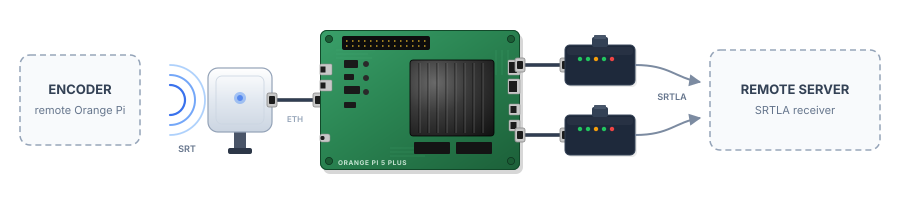

<div align="center">

# Belabox Duo

Bun-based controller for [BELABOX](https://belabox.net/)-style bonded streaming. One program covers three device types, and an optional control server manages a fleet of them from a browser.

[](https://github.com/majklovec/belabox-duo/actions)
[](https://bun.sh)
[](https://www.typescriptlang.org)

</div>

> [!WARNING]
> Development in progress — do not run in a production stream.

<p align="center">
  
</p>

## Roles

One binary, three device types. Pick the role with `--role`:

| Role | What it does |
| ---- | ------------ |
| `relay` (default) | Receives SRT from an encoder and bonds it out over all uplinks with [srtla_send](https://github.com/irlserver/srtla_send). Manages source routing, the uplinks file, and modems (ModemManager). |
| `encoder` | Runs [belacoder](https://github.com/BELABOX/belacoder) or [ceracoder](https://github.com/CERALIVE/ceracoder) with a GStreamer pipeline and sends SRT to a relay. No routing, modems, or `srtla_send` — does not need root. |
| `combined` | Encoder and relay in one box: encoder → local `srtla_send` → bonded uplinks. One Start/Stop drives both. |

```
encoder ──SRT──▶ relay ──SRTLA (bonded)──▶ SRTLA receiver
combined ─────────SRTLA (bonded)─────────▶ SRTLA receiver
        ▲                ▲
        └── control server (optional, WebSocket) ──┘
```

### Requirements

- [Bun](https://bun.sh)
- `srtla_send` (relay, combined)
- `belacoder`/`ceracoder` and GStreamer (encoder, combined)
- `iproute2` and ModemManager (`mmcli`) for bonding and modem management

## Getting started

```sh
# Relay: local web UI + API on :8085, watches interfaces, reloads srtla_send
sudo bun client.ts --host 0.0.0.0

# Encoder: pick a pipeline and the relay's SRT port in the UI
bun client.ts --role encoder --pipelines /usr/share/belacoder/pipelines

# Combined
sudo bun client.ts --role combined --pipelines /usr/share/belacoder/pipelines

# Relay: also start srtla_send immediately on startup
sudo bun client.ts --start-srtla 6000 rec.example.com 5000
```

Open `http://<device>:8085/`. The UI shows only what applies to the role.

For a local checkout with the bundled binaries, override their paths explicitly:

```sh
sudo SRTLA_REMOTE_TOKEN=token \
  ENCODER_BIN=./belacoder \
  SRTLA_SEND_BIN=./srtla_send \
  bun client.ts --port 8085 \
  --remote ws://127.0.0.1:8090/device \
  --role combined --pipelines ./pipeline
```

> [!NOTE]
> Use `SRTLA_REMOTE_TOKEN`, not `REMOTE_TOKEN` — the former is the variable the client reads. Placing the assignments **after** `sudo` passes them to the command without requiring a persistent shell environment.

### Options

| Option | Env | Default | Notes |
| ------ | --- | ------- | ----- |
| `--role` | `BELABOX_ROLE` | `relay` | `relay`, `encoder`, `combined` |
| `--host`, `--port` |  | `127.0.0.1`, `8085` | Local web UI and WebSocket API (`/ws`), always on |
| `--allow-origin` |  |  | Extra browser origins for `/ws` (comma-separated, `*` = any) |
| `--config` |  | `$TMPDIR/config.json` | Device config — settings, encoder, srtla target, autostart, modems. **Use a persistent path in production** |
| `--uplinks` |  | `$TMPDIR/srtla_ips.txt` | Uplinks file for `srtla_send` |
| `--start-srtla` |  |  | Relay/combined: start `srtla_send` on boot with `<listenPort> <remoteHost> <remotePort>` |
| `--srtla-reload` |  | `signal` | `signal` (SIGHUP) or `restart` |
| `--srtla-socket` | `SRTLA_CONTROL_SOCKET` | `$TMPDIR/srtla_send.sock` | `srtla_send` control socket (link stats, mode/quality); `""` disables it |
| `--debounce-ms` |  | `1500` | Interface-event debounce |
| `--pipelines` | `BELACODER_PIPELINES` | `/usr/share/belacoder/pipelines` | Pipeline files, including subdirectories |
| `--belacoder` | `ENCODER_BIN` | `belacoder` |  |
|  | `SRTLA_SEND_BIN` | `srtla_send` |  |
| `--bitrate-file` |  | `$TMPDIR/belacoder_br` | belacoder bitrate file (re-read on SIGHUP) |
| `--remote` | `SRTLA_REMOTE_URL` |  | Control server, e.g. `wss://ctl.example.com/device` |
| `--remote-token` | `SRTLA_REMOTE_TOKEN` |  | Prefer the env var (keeps it out of `ps`) |
| `--remote-interval` |  | `30` | Periodic status push in seconds (`0` = only on change) |
| `--remote-stats-interval` |  | `2` | `srtla_send` link-stats push to the control server in seconds (`0` = off) |
| `--dry-run` |  |  | Print `ip`/process actions instead of running them |

### Encoder pipelines

Pipelines are the belacoder GStreamer files under `--pipelines`, grouped by subdirectory (`generic/`, `rk3588/`, `jetson/`, …). Before launch the pipeline is adapted the way belaUI does: choose the ALSA audio card (or drop audio), switch AAC to Opus, and so on.

Every pipeline file must contain a non-empty GStreamer launch string — empty or whitespace-only files are rejected before belacoder starts (select another pipeline, or restore the file, if the UI reports `Pipeline is empty`). The selected pipeline must also match the available hardware and GStreamer plugins on the device; for example the Rockchip pipelines use `mpph265enc`, which is not available on a generic x86 host.

The settings page can also manage **GitHub pipeline repositories** in `author/repository` format. Files below the repository's `pipeline/` directory are imported recursively into `PIPELINES_DIR/author/repository/`. **Update all** refreshes every configured repository, replacing its local files so deleted upstream pipelines are removed too.

### Autostart

Tick **Autostart** in the UI (or call `autostart.set`) to resume the last stream whenever the service starts. It retries every 5 s until it succeeds (capture card, uplinks, or receiver not ready yet); any manual Start/Stop cancels a pending retry.

## Control server

`server.ts` lists all devices and serves the same web UI for each one at `/d/<id>/`, relaying commands to the device over its outbound connection — so devices behind NAT or on mobile networks can be managed. It also hosts fleet-wide **dashboards** that compose modules from any connected device.

```sh
SRTLA_DEVICE_TOKEN=devsecret SRTLA_UI_PASSWORD=uipass bun server.ts --port 8090

# on each device
SRTLA_REMOTE_TOKEN=devsecret bun client.ts --role encoder --remote wss://ctl.example.com/device
```

| Option | Env | Notes |
| ------ | --- | ----- |
| `--host`, `--port` |  | Default `0.0.0.0:8090` |
| `--device-token` | `SRTLA_DEVICE_TOKEN` | Shared device token |
| `--devices` |  | JSON file with per-device tokens `{"cam1": "token"}` |
| `--ui-user`, `--ui-password` | `SRTLA_UI_USER`, `SRTLA_UI_PASSWORD` | Browser login (HTTP Basic; user defaults to `admin`) |
| `--no-auth` |  | Local testing only |

> [!IMPORTANT]
> Run the server behind a TLS reverse proxy — device tokens and Basic auth need `wss://`/`https://`.

## Deployment

### systemd

```sh
sudo cp -r . /opt/srtla_relay
sudo cp deploy/srtla-relay.service /etc/systemd/system/
sudo cp deploy/srtla-relay.env /etc/default/srtla-relay   # set BELABOX_ROLE etc.
sudo systemctl enable --now srtla-relay

# control-server host
sudo cp deploy/srtla-control.service /etc/systemd/system/
sudo cp deploy/srtla-control.env /etc/default/srtla-control
sudo systemctl enable --now srtla-control
```

The units expect Bun at `/usr/local/bin/bun`. The device unit keeps its state in `/var/lib/srtla-relay/`, which autostart needs to survive a reboot.

### Docker

The control server ships as an image (see `Dockerfile` and `docker-compose.yaml`):

```sh
docker compose up -d
```

## API

The local `/ws` endpoint and the control server speak the same JSON protocol:

- request — `{ "id", "method", "params" }`
- response — `{ "type": "response", "id", "ok", … }`
- push — `{ "type": "event", "event": "status" | "log" | "srtla.stats", "data": … }`

The method list lives at the top of [`src/methods.ts`](src/methods.ts). Methods that do not apply to the device's role are rejected with code 409.

The cog in the device header opens a settings page. It uses `settings.get` / `settings.update` for the persistent device UUID, hostname, role, control-server URL, remote token, and header color. The UUID is the device's fixed identity on the control server — auto-assigned once, saved in the config file, and never changed (it survives hostname changes). Saving settings re-dials the control server, so the device re-registers with its new URL, token, hostname, and role without a service restart. Stream settings (pipeline, bitrate, audio, targets, scheduler) are saved automatically whenever they change.

## Modules

Every capability is a **self-contained module** under [`modules/`](modules/README.md) — a backend registration, a frontend card, local types, and styles. The core (`src/` + `public/`) never imports a module by id: it discovers, routes, and renders everything through the registries and the capability bus. The boundary is enforced by [`test/registries.test.ts`](test/registries.test.ts).

**Device modules** — run on the device, each shown as a card in the web UI:

| Module | What it does |
| ------ | ------------ |
| `encoder` | Runs and supervises the encoder process for encoder/combined devices: pipeline discovery (ids are paths under `--pipelines`, e.g. `rk3588/h265_hdmi_1440p25`), start/stop with automatic restart, and live bitrate changes. Supports **belacoder** (bitrate via a min/max file, re-read on SIGHUP) and **ceracoder** (INI config with balancer tuning). |
| `srtla` | Manages the `srtla_send` process for relay/combined devices: start/stop/reload (SIGHUP or restart), and applies scheduler options (mode, quality) over the control socket live. |
| `modems` | ModemManager (`mmcli`) integration: enumeration, per-modem state, signal quality, operator, and enable/disable/reset/connect/disconnect actions — wired into the bonding selection. |
| `obs-controller` | Owns the [obs-websocket](https://github.com/obsproject/obs-websocket) (v5) connection to a paired OBS Studio instance and forwards its events into the device event stream. Also runs the **low-bitrate switcher**: a pure state machine ([`switcher-engine.ts`](modules/obs-controller/switcher-engine.ts)) that watches SRT/OBS metrics and switches OBS between `normal` / `low` / `offline` scenes. |

**Channel widgets** — dashboard-only, run on the control server (device-independent); one hub per module serves all widgets of its kind:

| Widget | Source |
| ------ | ------ |
| `kick-stats` | Polls Kick's public channel API every 30 s; pushes live viewer/online stats for a line chart (1 h window). |
| `kick-chat` | Joins Kick's public chat (Pusher chatroom, no auth); pushes `kick.chat` events per channel. |
| `twitch-chat` | One IRC-over-websocket connection per channel (anonymous `justinfan` nick, no auth); IRCv3 tags for color and display name. |
| `youtube-chat` | Polls YouTube's live-chat endpoint per creator handle (~1 s cadence, no auth) via [`youtube-chat-next`](https://www.npmjs.com/package/youtube-chat-next). |
| `tiktok-chat` | One [`tiktok-live-connector`](https://www.npmjs.com/package/tiktok-live-connector) websocket per channel (no auth); the module owns its reconnection loop. |

All chat/stats widgets share the same guarantees: rolling message history so reconnects don't re-send, and a `seen` set that dedupes message ids across reconnects.

### How the module system works

Each `modules/<id>/` ships exactly four files:

- `backend.ts` — backend registration (runs in Bun on the host; no DOM)
- `frontend.tsx` — frontend registration (mithril components; no `../../src` imports)
- `types.ts` — this module's local types only (may import core types, never another module)
- `styles.css` — scoped under `.mod-<id>` (device card) or `.dash-card` (widget)

The **registration contract** is structural: the backend declares its `id`, a `configSchema` the UI renders its config form from, `secretFields` to mask, the ordered `methods` it answers and `events` it emits, `start`/`stop`/`dispatch`, an optional `status()` fragment, an optional `services.capabilities` map, an optional widget `hub`, and `dependencies`. The frontend mirrors the identity and adds the widget `component`, the device `cardBody(host, status)`, and widget hub/sink hooks. Field-by-field tables are in [`modules/README.md`](modules/README.md).

**Discovery** — the backend is a runtime `readdirSync` scan of `modules/*/` in [`src/registry.ts`](src/registry.ts): add a directory and it appears. The browser bundle cannot glob at runtime, so `scripts/gen-modules.ts` writes the gitignored `modules/.generated.frontend.ts` manifest from the same scan (wired into `predev`).

**Core ↔ module** — RPC methods are routed through the registry's method-owner map (built from each module's `methods` array), the UI fetches cards and widgets through accessors in [`src/registry.frontend.ts`](src/registry.frontend.ts), and cross-module services go over the **capability bus**: a module registers a capability under a dotted name (`stream.encoder`, `stream.srtla`) and consumers look it up by name through [`src/capabilities.ts`](src/capabilities.ts) instead of importing it. Each module side-effect-imports its own `styles.css`, so the core never pulls module CSS by id.

**Ordering** — `resolveOrder` topologically sorts modules by their `dependencies` (cycle-safe, id-sorted when no edges); `startModules`/`stopModules`/`buildStatus` all iterate that order, never a hand-maintained list.

**Adding a module** — `mkdir modules/<id>` with the four files above, register `cardBody` (device) or `component` + `createHub` (widget), optionally `dependencies`. No core edits for discovery — the scan and `predev` pick it up. Method and event names are frozen: renaming one is a breaking API change.

### OBS client

[`obs-client.ts`](obs-client.ts) is a **standalone device** for machines that run OBS Studio separately from the relay. It registers on the control server exactly like `client.ts` (stable UUID, `role: "obs"` in the hello) and proxies between the browser dashboards and OBS:

```sh
bun obs-client.ts --obs ws://127.0.0.1:4455 \
    --obs-password secret \
    --remote ws://10.0.0.5:8090/device --remote-token secret
```

It speaks the full obs-websocket v5 handshake (Hello → Identify → Identified), forwards `Request`/`RequestBatch` verbatim from the server, resolves responses by request id, and republishes OBS events as `obs.event` frames so dashboards pick up scene/stream/record changes. It auto-reconnects with exponential backoff, emits a synthetic `ObsDisconnected` on drop, and replays a state snapshot as real-shaped events on reconnect. The same `ObsClient` library (`src/obs/client.ts`) powers the `obs-controller` module in-process, so a relay with a local OBS needs no second websocket.

## Development

```sh
bun install

# control server (bundles the web UI on startup)
bun run dev

# tests
bun test

# compiled single-file binaries
bun run build:client   # → dist/client
bun run build:server   # → dist/server
```

Modules are discovered by a runtime scan of `modules/`; the manifests in `modules/.generated.*.ts` are produced by `scripts/gen-modules.ts` (wired into `predev`/`pretest`/`prebuild:*`). The UI is localized via the `.po` files in `i18n/` (12 languages).

## Credits

- [BELABOX](https://github.com/BELABOX) / [belabox.net](https://belabox.net/) by rationalirl — the bonded-protocol project this builds on. [Support the effort](https://github.com/sponsors/rationalirl)
- [CERALIVE/ceracoder](https://github.com/CERALIVE/ceracoder)
- [irlserver/srtla_send](https://github.com/irlserver/srtla_send)
